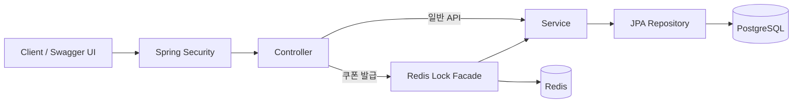
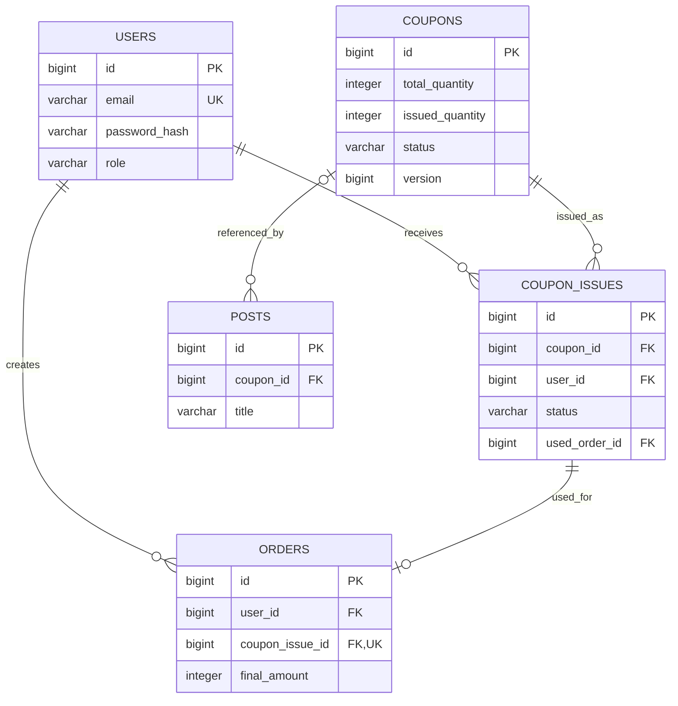

# Coupon Rush

한정 수량 쿠폰의 생성·발급·사용을 구현하고, 동시성 제어 방식에 따라 데이터 정합성과 요청 실패 양상이 어떻게 달라지는지 비교한 Spring Boot 백엔드 학습 프로젝트입니다.

`lock-lab` 브랜치에서는 쿠폰 발급 기능과 별도의 락 실험 테스트를 함께 살펴볼 수 있습니다. 현재 발급 API에는 Redis 분산 락을 적용했으며, 비교 실험은 로컬 환경의 한 JVM에서 진행했습니다.

## 핵심 실험과 배운 점

### 성공 건수와 실패 사유를 함께 확인하기

서로 다른 사용자 20명이 수량 5개의 쿠폰을 요청하는 조건에서 두 경로를 비교했습니다. 낙관적 락 테스트는 `CouponIssueService`를, Redis 락 테스트는 `CouponIssueRedisLockFacade`를 직접 호출합니다.

| 경로 | 테스트에서 확인하는 조건 |
| --- | --- |
| 낙관적 락, 재시도 없음 | 성공 1~5건, 버전 충돌 발생, 성공 건수 = DB 발급 수량 = 발급 내역 건수, 예상 밖 예외 0건 |
| Redis 락 + 낙관적 락 유지 | 성공 5건, 품절 15건, 버전 충돌·락 타임아웃·예상 밖 예외 0건, DB 발급 수량과 내역 각각 5건 |

`@Version`으로 충돌을 감지해도 요청이 자동으로 대기하거나 재시도되지는 않습니다. 따라서 재고를 초과하지 않는지뿐 아니라 실패가 품절인지 버전 충돌인지도 구분해야 했습니다. 현재 저장된 실행 기록에서는 두 경로 모두 5건이 발급됐고, 실패 사유가 달랐습니다. [실행 기록](docs/testing.md)과 [분석 과정](docs/troubleshooting/001-optimistic-lock-conflict.md)에 조건과 관측값을 정리했습니다.

### 락의 동작을 작은 실험으로 구분하기

| 방식 | 실험 환경 | 확인한 동작 | 고려할 점 |
| --- | --- | --- | --- |
| 락 없음 | Java 메모리 객체, 두 스레드 | 같은 값을 읽고 덮어쓰는 갱신 손실 | 실제 쿠폰 DB의 과거 장애를 재현한 실험은 아님 |
| `synchronized` | Java 메모리 객체, 두 스레드 | 같은 모니터를 사용하는 두 변경을 반영 | 다른 JVM과 모니터를 공유하지 않음 |
| 낙관적 락 | PostgreSQL, 두 트랜잭션 | 오래된 버전의 변경이 충돌로 롤백 | 충돌한 요청의 재시도는 별도 정책 |
| 비관적 락 | PostgreSQL, 두 트랜잭션 | 행 락을 사용해 두 변경을 반영 | 동일 DB를 사용하는 여러 인스턴스에도 적용 가능하며 DB 락 대기를 고려해야 함 |
| Redis 락 | PostgreSQL·Redis, 두 스레드 | 같은 락 키를 사용하는 두 변경을 반영 | 추가 인프라와 Redis 장애 의존성 발생 |

실험 환경이 다르므로 처리 시간으로 방식별 성능을 비교하지 않았습니다. 여러 서버 인스턴스, HTTP 부하, Redis 장애 상황도 검증 범위에 포함하지 않았습니다.

Redis는 공유 락과 DB 트랜잭션의 경계를 학습하기 위해 선택했습니다. DB 비관적 락도 가능한 대안이며, Redis의 성능 우위를 확인한 선택은 아닙니다. 구체적인 판단은 [ADR-003](docs/adr/003-use-redis-lock-for-coupon-issuance.md)에 기록했습니다.

## 시스템 구성



쿠폰 발급은 `락 획득 → Service 트랜잭션 시작 → 발급 수량·내역 저장 → 커밋 → 락 해제` 순서로 처리합니다. Facade가 별도 Spring Bean인 Service를 호출하므로, 현재 API 경로에서는 트랜잭션 종료까지 락의 보호 범위에 포함됩니다.

도메인은 `auth`, `user`, `coupon`, `order`, `post`로 구분하고, 내부에 Controller·Service·Repository·Entity·DTO를 배치했습니다. `common`은 인증 설정과 공통 예외 처리를 담당합니다. `post`는 현재 엔티티와 Repository까지만 구현했습니다.

## 기술 스택

| 구분 | 기술 |
| --- | --- |
| Language / Framework | Java 21, Spring Boot 3.5, Spring MVC |
| Data | Spring Data JPA, PostgreSQL 16, Flyway |
| Security | Spring Security, OAuth2 Resource Server, JWT, BCrypt |
| Distributed Lock | Redis 7, Redisson |
| API Documentation | springdoc-openapi, Swagger UI |
| Test / Build | JUnit 5, AssertJ, Spring Boot Test, Testcontainers, Gradle |

## 주요 기능과 API

| Method | Endpoint | 기능 | 접근 권한 |
| --- | --- | --- | --- |
| `POST` | `/api/users` | 회원가입, BCrypt 비밀번호 저장 | 공개 |
| `POST` | `/api/auth/login` | 로그인 및 JWT 발급 | 공개 |
| `GET` | `/api/users/{userId}` | 사용자 단건 조회 | 인증 필요 |
| `POST` | `/api/coupons` | 수량·할인 금액·기간을 지정해 쿠폰 생성 | `ADMIN` |
| `GET` | `/api/coupons` | 쿠폰 목록 조회 | 공개 |
| `GET` | `/api/coupons/{couponId}` | 쿠폰 단건 조회 | 공개 |
| `POST` | `/api/coupons/{couponId}/issues` | 상태·기간·재고·중복 여부 확인 후 발급 | `USER`, `ADMIN` |
| `POST` | `/api/orders` | 본인에게 발급된 쿠폰으로 주문 생성 | `USER`, `ADMIN` |

쿠폰 발급과 주문 생성의 사용자 ID는 JWT의 `subject`에서 가져옵니다. `role`은 API 권한 검사에 사용하며, 미인증 요청은 401, 권한이 부족한 요청은 403으로 응답합니다. 주문 생성과 쿠폰 사용 상태 변경은 한 트랜잭션으로 처리하고, DB 유일 제약으로 같은 발급 쿠폰의 중복 주문을 제한합니다.

쿠폰은 `READY` 상태로 생성되며 발급은 `OPEN` 상태에서만 가능합니다. 현재 브랜치에는 상태 전환 API가 없어, 수동 데모에는 아래의 로컬 데이터 준비 과정이 필요합니다.

## 데이터베이스 구조



주요 관계와 컬럼을 표시한 ERD입니다. 게시글의 쿠폰 연결은 선택 사항입니다. 전체 스키마는 [Flyway 마이그레이션](src/main/resources/db/migration/V1__init_schema.sql)으로 관리하고, Hibernate의 `ddl-auto=validate`로 엔티티 매핑을 검사합니다.

| 보호 수단 | 담당하는 규칙 |
| --- | --- |
| `UNIQUE(coupon_id, user_id)` | 같은 사용자의 동일 쿠폰 중복 발급 제한 |
| `UNIQUE(orders.coupon_issue_id)` | 같은 발급 쿠폰을 사용하는 중복 주문 제한 |
| 수량 `CHECK` | 쿠폰 행의 `0 <= issued_quantity <= total_quantity` 제한 |
| 트랜잭션·락·`@Version` | 발급 수량과 내역 변경을 함께 처리하고 동시 변경을 제어·감지 |

수량 CHECK만으로 발급 내역 건수와 카운터의 일치가 보장되지는 않습니다. 두 값의 일치는 발급 트랜잭션과 동시성 테스트에서 함께 확인합니다.

## 실행 방법

JDK 21과 Docker 및 Docker Compose가 필요합니다.

### 1. 브랜치 복제와 인프라 실행

```bash
git clone --branch lock-lab https://github.com/seo-ju-yeon/coupon-rush.git
cd coupon-rush
docker compose up -d
docker compose ps
```

PostgreSQL은 `localhost:5432`, Redis는 `localhost:6379`를 사용합니다. PostgreSQL이 연결을 받을 준비가 되었는지는 다음 명령으로 확인할 수 있습니다.

```bash
docker compose exec postgres pg_isready -U couponrush -d coupon_rush
```

### 2. JWT 키 설정과 애플리케이션 실행

```bash
export JWT_SECRET="$(openssl rand -base64 32)"
./gradlew bootRun
```

IntelliJ IDEA로 실행한다면 실행 구성의 환경 변수에 `JWT_SECRET`을 등록합니다. [.env.example](.env.example)은 설정값 예시이며, 파일을 복사하는 것만으로 `bootRun`에 환경 변수가 주입되지는 않습니다.

Flyway 마이그레이션과 Hibernate 검증이 완료되면 [Swagger UI](http://localhost:8080/swagger-ui/index.html)에서 API를 호출할 수 있습니다. 명세는 [OpenAPI JSON](http://localhost:8080/v3/api-docs)으로 제공합니다.

### 3. 로컬에서 생성·발급·주문 확인

현재 없는 관리자 등록·쿠폰 상태 전환 API를 대신해, 데모용 데이터만 로컬 DB에서 준비합니다.

1. Swagger의 `POST /api/users`로 `admin@example.com` 계정을 생성합니다. 이메일·닉네임·8자 이상의 비밀번호를 입력합니다.
2. 아래 명령으로 해당 계정의 역할을 변경합니다.

```bash
docker compose exec postgres psql -U couponrush -d coupon_rush -c "UPDATE users SET role = 'ADMIN' WHERE email = 'admin@example.com' RETURNING id, email, role;"
```

3. `POST /api/auth/login`으로 로그인하고 응답의 `accessToken`을 Swagger의 **Authorize**에 입력합니다. 역할 변경 전에 발급한 토큰이 있다면 다시 로그인해야 합니다.
4. `POST /api/coupons`로 쿠폰을 생성합니다. 시작 일시는 현재보다 이전, 종료 일시는 현재보다 이후로 입력하고 응답의 `id`를 확인합니다.
5. 다음 SQL의 `1`을 생성된 쿠폰 ID로 바꾸어 실행합니다. 결과가 `OPEN`인지 확인합니다.

```bash
docker compose exec postgres psql -U couponrush -d coupon_rush -c "UPDATE coupons SET status = 'OPEN', version = version + 1, updated_at = CURRENT_TIMESTAMP WHERE id = 1 AND status = 'READY' RETURNING id, status, starts_at, ends_at;"
```

6. 별도 일반 사용자 계정을 생성하고 로그인합니다. Swagger의 토큰을 해당 사용자의 것으로 교체한 뒤 `POST /api/coupons/{couponId}/issues`를 호출합니다. 요청 본문은 필요하지 않습니다.
7. 발급 응답의 `id`를 `couponIssueId`로 지정하고, 할인 금액 이상의 `originalAmount`로 `POST /api/orders`를 호출합니다. 같은 쿠폰의 재발급과 사용한 발급 내역의 재사용은 거부됩니다.

### 4. 종료

```bash
docker compose down
```

PostgreSQL 데이터도 삭제하고 처음부터 시작하려면 `docker compose down -v`를 사용합니다.

## 테스트

Docker가 실행 중이어야 합니다. Gradle 테스트 작업은 테스트 전용 JWT 키를 주입하므로 별도의 `JWT_SECRET` 설정이 필요하지 않습니다.

| 범위 | 확인 내용 |
| --- | --- |
| Repository / Service | JPA 매핑, 제약조건, 비즈니스 규칙, 트랜잭션 롤백 |
| Controller / Security | 요청 검증, HTTP 응답, 인증·인가 규칙 |
| JWT | 클레임과 유효기간 설정, 위조 서명 거부 |
| 동시성 | 락 방식별 동작, 실패 사유, 성공 건수와 DB 상태의 일치 |

전체 테스트에는 로컬 PostgreSQL을 사용하는 `CouponRushApplicationTests`가 포함됩니다. 앞의 Compose 실행과 DB 준비 확인을 마친 뒤 실행합니다.

```bash
./gradlew test --rerun-tasks
```

락 실험과 실제 쿠폰 발급 동시성 테스트만 실행하려면 다음 명령을 사용합니다. 이 테스트들은 Testcontainers로 PostgreSQL과 필요한 Redis를 준비합니다.

```bash
./gradlew test --rerun-tasks \
  --tests 'dev.portfolio.couponrush.lock.*' \
  --tests 'dev.portfolio.couponrush.domain.coupon.service.CouponConcurrencyTest' \
  --tests 'dev.portfolio.couponrush.domain.coupon.service.CouponRedisLockConcurrencyTest'
```

기존 실행 기록은 **81개 중 80개 성공, `contextLoads()` 1개 실패**입니다. 로컬 DB 연결 실패의 원인과 테스트별 환경 차이는 [테스트 실행 기록](docs/testing.md)과 [TS-002](docs/troubleshooting/002-testcontainers-context-load.md)에 정리했습니다.

## 설계 결정과 트러블슈팅

기술 선택의 근거는 ADR에, 관측한 증상과 원인 분석은 TS에 기록했습니다.

| 구분 | 문서 |
| --- | --- |
| ADR | [작성 기준과 목록](docs/adr/README.md) |
| ADR-001 | [PostgreSQL과 Flyway 기반 데이터베이스 환경](docs/adr/001-use-postgresql-and-flyway.md) |
| ADR-002 | [Spring Security 기반 JWT 인증·인가](docs/adr/002-use-jwt-authentication.md) |
| ADR-003 | [Redis 분산 락과 쿠폰 발급 트랜잭션](docs/adr/003-use-redis-lock-for-coupon-issuance.md) |
| TS | [트러블슈팅 목록](docs/troubleshooting/README.md) |
| TS-001 | [초과 발급은 막았는데 왜 요청이 충돌로 실패할까?](docs/troubleshooting/001-optimistic-lock-conflict.md) |
| TS-002 | [Testcontainers를 사용하는데 왜 전체 테스트에서 하나만 실패할까?](docs/troubleshooting/002-testcontainers-context-load.md) |

## 한계와 다음 과제

- `contextLoads()`의 DB 환경을 Testcontainers로 통일하고 로컬 DB 없이 전체 테스트를 검증합니다.
- 관리자 계정 준비와 쿠폰 상태 전환을 API·초기 데이터 정책으로 정리합니다.
- 같은 사용자 중복 요청, 서로 다른 쿠폰, 다중 인스턴스와 Redis 장애·타임아웃 경로의 테스트를 추가합니다.
- 동일한 조건의 부하 테스트로 처리량·응답 시간·실패율을 측정한 뒤 락 전략을 다시 평가합니다.
- 현재 없는 Refresh Token, 로그아웃·토큰 폐기 기능의 필요성과 정책을 검토합니다.
